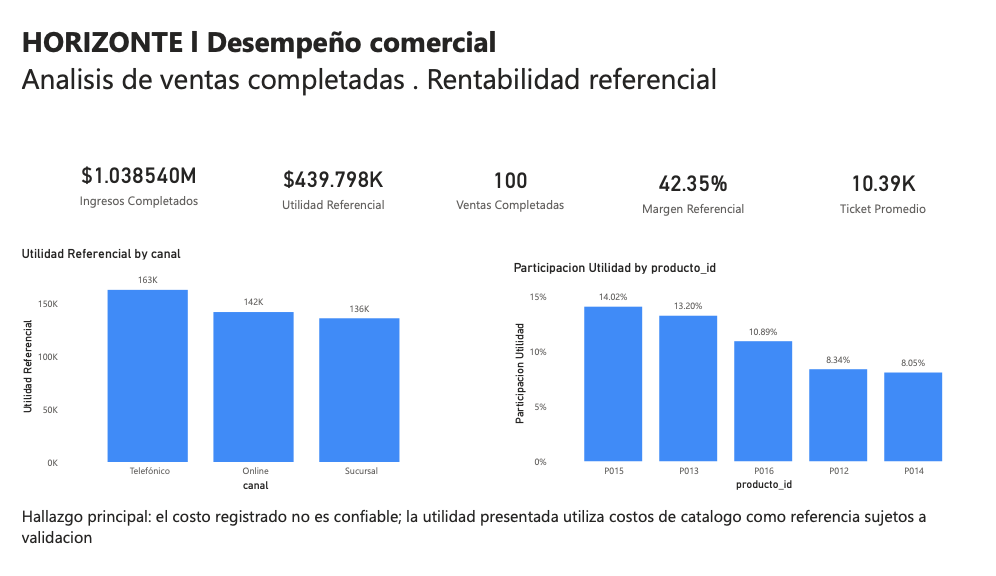
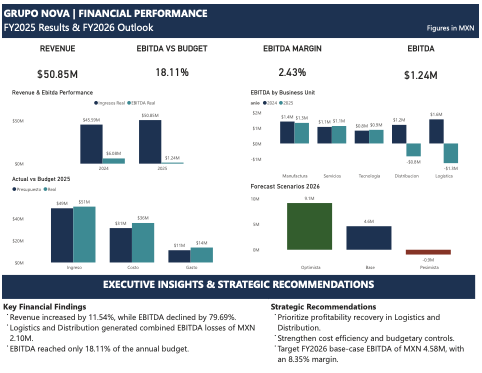

# Finance & Business Analytics Portfolio

## Professional Profile

Finance and banking professional with over 15 years of experience in financial services, commercial management, business performance and team leadership.

Combining financial expertise and business management experience with data analytics, business intelligence, financial modeling and reporting automation.

## Areas of Expertise

- Financial Planning & Analysis (FP&A)
- Financial Performance Analysis
- Budgeting and Forecasting
- Business Intelligence
- Commercial Performance
- Profitability Analysis
- Credit Risk Analysis
- Data Analytics
- Executive Reporting
- Data Storytelling

## Technical Toolkit

| Technology | Application |
|---|---|
| Excel | Financial analysis, modeling and reporting |
| SQL / PostgreSQL | Data extraction, transformation and analysis |
| Python | Data processing and reporting automation |
| Power BI | Business intelligence and executive dashboards |
| DAX | Analytical measures and performance indicators |
| Git / GitHub | Version control and project documentation |
| Statistics | Quantitative business analysis |

## Featured Projects

### 01 — Comercializadora Horizonte

**Business & Financial Analytics**

Independent project focused on commercial performance, data quality, profitability and executive decision-making.

**Technologies:** SQL, Python, Excel and Power BI.

**Key analytical results:**

- MXN 1.04 million in revenue.
- 100 completed sales.
- 782 units sold.
- Estimated gross margin of 42.35%.
- Identification of significant transaction cost inconsistencies.

Profitability estimates are based on reference catalog costs.

[Project documentation](unidad_09_proyecto_profesional/README_HORIZONTE.md)

[Excel report](unidad_09_proyecto_profesional/data/Horizonte_Analisis_Ejecutivo.xlsx)

[Power BI dashboard](unidad_09_proyecto_profesional/powerbi/Horizonte_Dashboard_Ejecutivo.pbix)

### 02 — Grupo Nova

**Financial Planning & Analysis**

Corporate financial analysis project focused on financial performance, budget variance, profitability, cost management and scenario forecasting.

**Technologies:** SQL, Python, Excel, Power BI and DAX.

**Key analytical results:**

- FY2025 revenue of MXN 50.85 million.
- Revenue growth of 11.54%.
- EBITDA margin of 2.43%.
- Identification of profitability deterioration.
- Development of three financial forecast scenarios.

[Project documentation](unidad_10_experiencia_portfolio/README_NOVA.md)

[Excel financial report](unidad_10_experiencia_portfolio/excel/Reporte_Financiero_Grupo_Nova.xlsx)

[Executive report — PDF](unidad_10_experiencia_portfolio/powerbi/Grupo_Nova_Executive_Financial_Report.pdf)

[Power BI dashboard](unidad_10_experiencia_portfolio/powerbi/Grupo_Nova_Financial_Performance.pbix)

## Additional Applied Projects

### Distribuidora Occidente

Guided business analytics project covering transactional data, regional performance, customer analysis and product profitability.

Original dataset:

- 300 customers.
- 40 products.
- 3,000 sales transactions.
- 7,570 sales detail records.

Pending final portfolio documentation.

## Portfolio Development Roadmap

| ID | Project | Status |
|---|---|---|
| 01 | Comercializadora Horizonte | Developed |
| 02 | Grupo Nova — FP&A | Developed |
| 03 | Corporate Financial Modeling | Planned |
| 04 | Corporate Financial Performance | Planned |
| 05 | Financial Forecasting | Planned |
| 06 | Budget & Variance Analysis | Planned |
| 07 | Advanced SQL Analytics | Planned |
| 08 | Financial Reporting Automation | Planned |
| 09 | Credit Risk Analysis | Planned |
| 10 | Executive BI Dashboard | Planned |
| 11 | Supply Chain Analytics | Planned |
| 12 | Statistical Business Analysis | Planned |

## Professional Approach

- Connect financial performance with business strategy.
- Validate data before drawing conclusions.
- Translate analytical findings into business recommendations.
- Document assumptions and analytical limitations.
- Develop reproducible and transparent analytical workflows.
- Communicate results clearly to technical and executive audiences.

## Portfolio Status

This portfolio is under continuous development. Featured projects are educational business cases, and their financial results remain subject to final reconciliation.

Last updated: November 2026.

## Dashboard Previews

### Comercializadora Horizonte

[Download Executive Report (PDF)](unidad_09_proyecto_profesional/powerbi/Horizonte_Reporte_Ejecutivo.pdf)

### Grupo Nova

