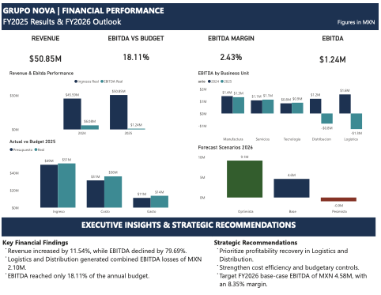
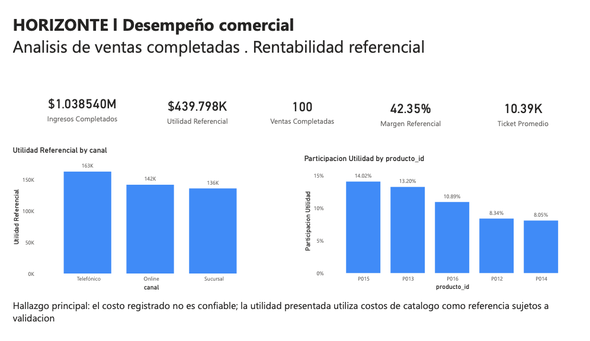

# Financial Analytics & Business Intelligence Portfolio

### Rene Leon Delgadillo

Corporate Finance | FP&A | Financial Analysis | Data Analytics | Business Intelligence

## Professional Profile

Finance and business management professional with experience in banking, financial planning, profitability analysis, commercial strategy and executive decision-making.

Master's degree in Corporate Finance, combining financial management experience with analytical tools to transform data into actionable business insights.

## Featured Projects

### 01. Grupo Nova — Financial Planning & Analysis

Financial performance analysis, budgeting, forecasting, EBITDA, variance analysis and scenario modeling.

**Key analytical results:**

- FY2025 Revenue: MXN 50.85 million.
- FY2025 EBITDA: MXN 1.24 million.
- EBITDA Margin: 2.43%.
- FY2026 Base Scenario EBITDA: MXN 4.58 million.

[Explore Grupo Nova Project](unidad_10_experiencia_portfolio/)

### 02. Comercializadora Horizonte — Business Analytics

End-to-end business analysis covering data quality, SQL transformations, financial indicators, commercial performance and executive reporting.

**Key analytical results:**

- Revenue analyzed: MXN 1,038,540.
- Completed sales: 100.
- Units sold: 782.
- Reference-based profit margin: 42.35%.

[Explore Horizonte Project](unidad_09_proyecto_profesional/)

## Technical Skills

| Area | Tools and Competencies |
| --- | --- |
| Corporate Finance | FP&A, Budgeting, Forecasting, P&L, EBITDA |
| Data Analysis | SQL, PostgreSQL, Python, Pandas |
| Business Intelligence | Power BI, DAX, Power Query |
| Financial Modeling | Microsoft Excel, Scenario Analysis |
| Data Management | Data Cleaning, ETL, Data Validation |
| Business Management | KPIs, Strategy, Profitability Analysis |
| Development | Git, GitHub, Visual Studio Code |

## Professional Approach

- Connect financial performance with business strategy.
- Validate data before drawing conclusions.
- Translate analytical findings into business recommendations.
- Develop transparent and reproducible analytical workflows.
- Communicate results to technical and executive audiences.

## Additional Documentation

- [Detailed Professional Portfolio](PORTFOLIO.md)
- [Original Academic Documentation](README_ACADEMICO.md)

## Professional Contact

[LinkedIn Profile](https://www.linkedin.com/in/rene-leon-delgadillo-12a01a302/)

Guadalajara, Jalisco, Mexico.

## Data Disclaimer

All featured projects use simulated business data for educational and portfolio purposes. Financial results remain subject to final reconciliation. Reference-based profitability estimates do not represent audited financial results.

Last updated: November 2026.
