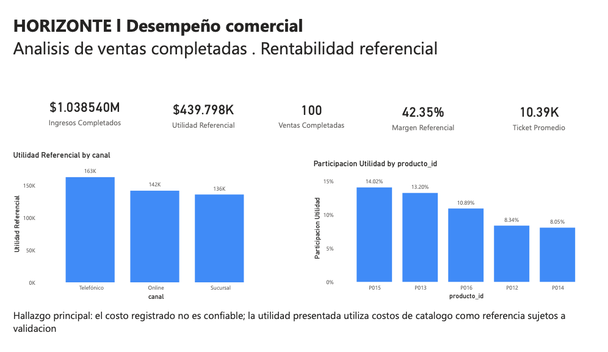

# Comercializadora Horizonte — Business & Financial Analytics

## Project Overview

Independent portfolio project focused on commercial performance, profitability analysis, data quality and executive decision-making.

The project integrates SQL, Python, Excel and Power BI to transform transactional data into actionable business insights.

## Business Objectives

- Evaluate sales performance and profitability.
- Identify data quality issues affecting financial indicators.
- Analyze performance by product, customer and sales channel.
- Develop executive reports and business recommendations.

## Technology Stack

- PostgreSQL
- SQL
- Python and pandas
- Microsoft Excel
- Microsoft Power BI
- Git and GitHub

## Dataset

The original dataset contains:

- 40 customers.
- 16 products.
- 121 sales headers.
- 240 sales detail records.

Data quality procedures included duplicate identification, orphan record detection and validation of transaction quantities.

## Analytical Workflow

1. Data inspection and quality assessment.
2. SQL-based data preparation and integration.
3. Financial and commercial analysis.
4. Python-based KPI generation.
5. Excel reporting.
6. Power BI executive visualization.
7. Business interpretation and recommendations.

## Key Financial Indicators

| Indicator | Result |
|---|---:|
| Completed sales | 100 |
| Units sold | 782 |
| Revenue | MXN 1,038,540 |
| Reference cost of goods sold | MXN 598,742 |
| Estimated gross profit | MXN 439,798 |
| Estimated gross margin | 42.35% |

## Key Findings

- Recorded transaction costs presented significant inconsistencies.
- Product catalog costs were used as an alternative reference for profitability analysis.
- Sales volume and profitability rankings differed across products.
- Revenue alone was insufficient to determine the most financially valuable products.

## Business Recommendations

- Investigate and reconcile transaction cost inconsistencies.
- Establish systematic data quality controls.
- Monitor profitability alongside sales volume.
- Incorporate product and customer profitability into commercial decisions.

## Project Deliverables

- [Python analysis](python/analisis_horizonte.py)
- [Analytical dataset](python/comercializadora_horizonte_analisis.csv)
- [Executive Excel report](data/Horizonte_Analisis_Ejecutivo.xlsx)
- [Power BI dashboard](powerbi/Horizonte_Dashboard_Ejecutivo.pbix)

## Limitations

This project is an educational business case, not an audited financial report.

Catalog costs represent reference values and may not reflect actual historical transaction costs. Therefore, gross profit and gross margin should be interpreted as estimates.

Full cross-tool reconciliation and end-to-end reproducibility remain subject to final validation.

## Project Status

Technical development completed. Final portfolio documentation and validation in progress.

November 2026.

## Executive Dashboard

[Download Executive Report (PDF)](powerbi/Horizonte_Reporte_Ejecutivo.pdf)
