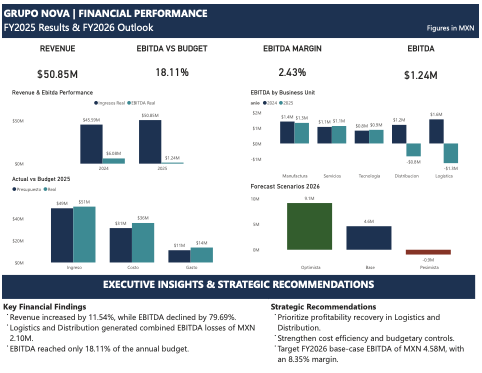

# Grupo Nova — Financial Planning & Analysis

## Project Overview

Financial Planning and Analysis (FP&A) portfolio project focused on corporate financial performance, budget management, profitability, cost optimization and financial forecasting.

The project integrates financial analysis with SQL, Python, Excel and Power BI to support executive decision-making.

## Business Objectives

- Evaluate financial performance across fiscal years.
- Identify revenue growth and profitability trends.
- Analyze actual results against budget.
- Identify underperforming business units and cost centers.
- Develop financial forecasts under alternative business scenarios.
- Communicate actionable recommendations to executive management.

## Technology Stack

- PostgreSQL
- SQL
- Python
- Microsoft Excel
- Microsoft Power BI
- DAX
- Git and GitHub

## Data Architecture

The project integrates four primary datasets:

- Business units.
- Cost centers.
- Financial accounts.
- Financial transactions.

Financial information is consolidated into an analytical dataset for reporting and visualization.

## Analytical Workflow

1. Database creation and data integration.
2. Financial data validation.
3. Income statement analysis.
4. Business unit performance analysis.
5. Budget variance analysis.
6. Cost center evaluation.
7. Monthly financial performance analysis.
8. Financial reporting automation.
9. Forecasting and scenario analysis.
10. Executive dashboard development.

## Preliminary Financial Results — FY2025

| Financial Indicator | Result |
|---|---:|
| Revenue | MXN 50.85 million |
| Revenue growth vs. FY2024 | 11.54% |
| EBITDA | MXN 1.24 million |
| EBITDA margin | 2.43% |
| EBITDA variation vs. FY2024 | -79.69% |
| EBITDA budget attainment | 18.11% |

## FY2026 Forecast

| Scenario | Projected EBITDA |
|---|---:|
| Pessimistic | MXN -935,735.67 |
| Base Case | MXN 4,583,732.98 |
| Optimistic | MXN 9,098,539.04 |

The base case projects an EBITDA margin of approximately 8.35%.

## Key Findings

- Revenue growth did not translate into improved profitability.
- EBITDA declined significantly compared with the previous fiscal year.
- Financial performance fell below budget expectations.
- Logistics and Distribution generated combined losses of approximately MXN 2.10 million.
- Scenario analysis highlights the importance of cost management and operational efficiency.

## Business Recommendations

- Investigate the main drivers of EBITDA deterioration.
- Establish profitability improvement plans for underperforming business units.
- Strengthen budget monitoring and variance analysis.
- Evaluate operational expenses and cost allocation.
- Implement periodic financial forecasting.
- Monitor financial performance against defined recovery targets.

## Project Deliverables

- [SQL scripts](sql/)
- [Python financial automation](python/01_automatizacion_financiera.py)
- [Consolidated financial dataset](data/processed/finanzas_consolidado.csv)
- [Excel financial report](excel/Reporte_Financiero_Grupo_Nova.xlsx)
- [Power BI executive dashboard](powerbi/Grupo_Nova_Financial_Performance.pbix)
- [Executive financial report — PDF](powerbi/Grupo_Nova_Executive_Financial_Report.pdf)

## Professional Competencies

- Financial Planning & Analysis
- Budgeting and Forecasting
- Financial Performance Management
- Variance Analysis
- Cost Center Analysis
- Scenario Planning
- Financial Reporting Automation
- Business Intelligence
- Executive Communication
- Data Storytelling

## Limitations

This project is an educational corporate financial case and does not represent audited financial statements.

Forecast results depend on the assumptions applied to each scenario and should not be interpreted as guaranteed outcomes.

Financial figures are preliminary portfolio results pending final reconciliation across SQL, Python, Excel and Power BI.

## Project Status

Technical development completed. Final portfolio validation and professional documentation in progress.

November 2026.

## Executive Dashboard

[Download Executive Report (PDF)](powerbi/Grupo_Nova_Executive_Financial_Report.pdf)
